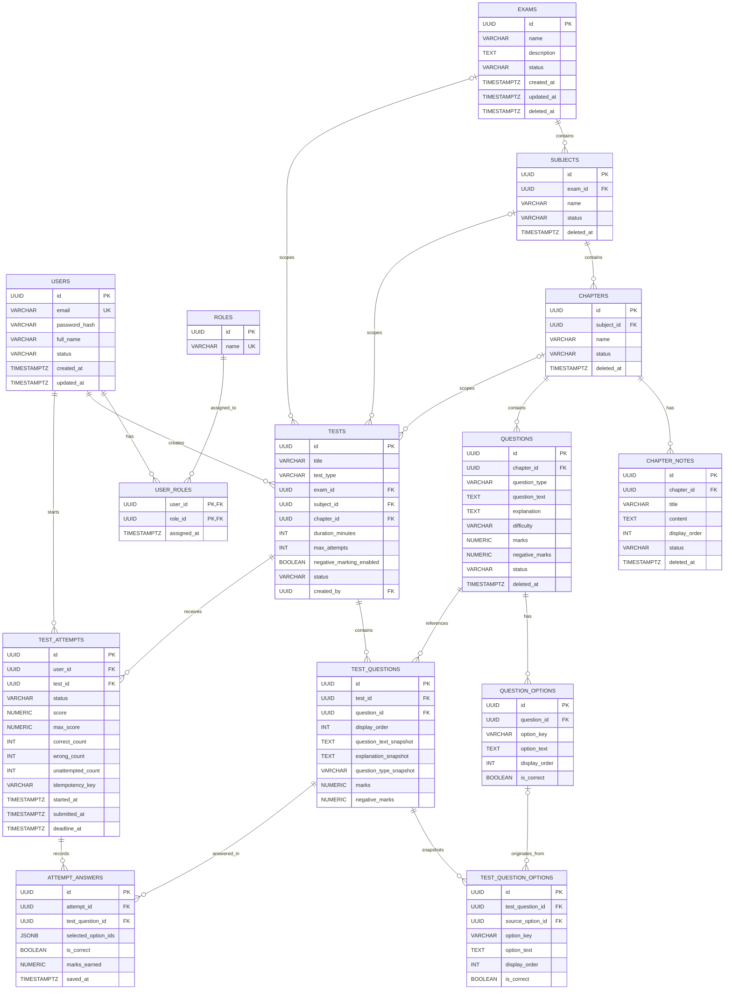

## Database Design

VrnxStudy uses PostgreSQL to store user accounts, learning content, question banks, tests, and student attempts.

The schema separates reusable questions from published test questions. When a question is added to a test, its content and options can be stored as snapshots, helping preserve the version used in that test.

### Entity Relationship Diagram



### How the schema is organized

**1. Users and roles**

- `users` stores user account information.
- `roles` defines the supported roles: `ROLE_STUDENT`, `ROLE_ADMIN`, and `ROLE_SUPER_ADMIN`.
- `user_roles` connects users and roles through a many-to-many relationship.

**2. Learning content**

The learning hierarchy is:

`EXAMS → SUBJECTS → CHAPTERS`

- `chapter_notes` stores notes associated with chapters.
- `questions` stores the reusable question bank.
- `question_options` stores the options belonging to each question.

**3. Test builder**

- `tests` defines a test, its scope, duration, attempt limit, and marking configuration.
- `test_questions` associates questions with tests and stores snapshots of question content and marking values.
- `test_question_options` stores the options associated with each test-question snapshot.

A question can be reused across different tests without requiring each test to depend entirely on the current question text.

**4. Student attempts**

- `test_attempts` tracks a user's attempt, including status, score, timing, and answer counts.
- `attempt_answers` stores the answer record for each test question within an attempt.
- `selected_option_ids` is a JSONB array containing selected option IDs.

The schema permits an answer to remain ungraded while `is_correct` is `NULL`.

### Database constraints and indexes

The schema uses several PostgreSQL features to protect data integrity:

- UUID primary keys generated with `gen_random_uuid()`.
- Foreign keys to enforce relationships between records.
- Unique constraints to prevent duplicate role assignments, question options, and test-question entries.
- Check constraints to validate statuses, difficulty levels, marking values, and test scope.
- Indexes on commonly queried foreign keys and status fields.
- Soft-delete timestamps on selected learning-content tables.
- Flyway migrations to manage schema changes.

The application uses Hibernate schema validation rather than relying on Hibernate to create or modify the database schema.

```properties
spring.jpa.hibernate.ddl-auto=validate
spring.flyway.enabled=true
spring.flyway.locations=classpath:db/migration
```

> **Note:** `attempt_answers.selected_option_ids` is a JSONB array, not a foreign-key relationship to `test_question_options`. Application-level validation is therefore important to ensure that selected options belong to the relevant test question.
>
> ## ⚙️ Environment Configuration

VrnxStudy uses environment variables to configure database connections and other environment-specific settings.

Sensitive information, such as database passwords, should not be hardcoded in source files or committed to GitHub.

### 1. Configure Environment Variables

The backend expects these database environment variables:

| Variable | Purpose |
|---|---|
| `DB_URL` | PostgreSQL JDBC connection URL |
| `DB_USERNAME` | Database username |
| `DB_PASSWORD` | Database password |

Example configuration:

```properties
spring.datasource.url=${DB_URL}
spring.datasource.username=${DB_USERNAME}
spring.datasource.password=${DB_PASSWORD}
```

Spring Boot resolves these placeholders from the environment when the application starts.

### 2. Create a Local `.env` File

Create a `.env` file in the backend project's root directory, alongside `pom.xml`.

```dotenv
DB_URL=jdbc:postgresql://localhost:5432/vrnxstudy
DB_USERNAME=your_database_username
DB_PASSWORD=your_database_password
```

Replace the example values with your actual database connection details.

**Important:** A `.env` file is not automatically loaded by Spring Boot. You must either export its variables into the process environment or use a tool that explicitly loads the file.

For Supabase PostgreSQL, use the appropriate connection details from your Supabase dashboard. The URL must be compatible with the PostgreSQL JDBC driver, normally starting with `jdbc:postgresql://`.

### 3. Protect Environment Variables with `.gitignore`

Add these entries to the repository's `.gitignore` file:

```gitignore
# Environment variables and secrets
.env
.env.*
!.env.example

# Build output
target/

# IDE files
.idea/
*.iml
.vscode/
```

Check your existing `.gitignore` before adding these entries.

Create a separate `.env.example` file containing placeholders only:

```dotenv
DB_URL=jdbc:postgresql://localhost:5432/your_database
DB_USERNAME=your_username
DB_PASSWORD=replace_with_your_password
```

Commit `.env.example`, but never commit a file containing real credentials.

### 4. Run the Application Using Environment Variables

#### Option A: Git Bash

From the backend directory:

```bash
export DB_URL="jdbc:postgresql://localhost:5432/vrnxstudy"
export DB_USERNAME="your_database_username"
export DB_PASSWORD="your_database_password"

mvn spring-boot:run
```

These variables are available to processes started from that Git Bash session. They do not automatically configure unrelated terminals or applications.

#### Option B: Windows PowerShell

```powershell
$env:DB_URL="jdbc:postgresql://localhost:5432/vrnxstudy"
$env:DB_USERNAME="your_database_username"
$env:DB_PASSWORD="your_database_password"

mvn spring-boot:run
```

These environment variables apply to the current PowerShell session and its child processes.

#### Option C: IntelliJ IDEA

1. Open **Run → Edit Configurations**.
2. Select the Spring Boot run configuration for the backend.
3. Find the **Environment variables** field.
4. Add `DB_URL`, `DB_USERNAME`, and `DB_PASSWORD`.
5. Save the configuration and run the application.

If your IntelliJ version supports loading environment files directly, you can configure the `.env` file there. Otherwise, set the variables individually or use a supported environment-file plugin.

---

## 🧩 Spring Boot Profiles

Spring profiles allow the application to use different configurations for development, testing, and production without maintaining separate application codebases.

For example:

| Profile | Intended use |
|---|---|
| `dev` | Local development |
| `test` | Automated tests and test-specific configuration |
| `prod` | Production deployment |

### 1. Create Profile-Specific Configuration Files

Inside `src/main/resources/`, organize the configuration files as follows:

```text
src/main/resources/
├── application.properties
├── application-dev.properties
├── application-test.properties
└── application-prod.properties
```

The files have different responsibilities.

**`application.properties`**

Contains shared configuration:

```properties
spring.application.name=vrnxstudy-api

spring.jpa.hibernate.ddl-auto=validate

spring.flyway.enabled=true
spring.flyway.locations=classpath:db/migration
```

**`application-dev.properties`**

Contains development-specific settings:

```properties
# Local development configuration
# Database credentials are provided through environment variables.

logging.level.org.springframework.web=DEBUG
```

**`application-test.properties`**

Contains settings specific to the test environment:

```properties
# Test environment configuration

spring.jpa.hibernate.ddl-auto=validate
spring.flyway.enabled=true
spring.flyway.locations=classpath:db/migration
```

**`application-prod.properties`**

Contains production-specific settings:

```properties
# Production configuration
# Credentials must be provided by the deployment environment.

spring.jpa.hibernate.ddl-auto=validate
spring.flyway.enabled=true
spring.flyway.locations=classpath:db/migration
```

These are example configurations. Add only properties appropriate to the application's actual requirements. A test profile should use a dedicated test database, not the production database.

### 2. Activate a Spring Profile

Spring Boot supports activating a profile when starting the application.

**Run with the development profile:**

```bash
mvn spring-boot:run -Dspring-boot.run.profiles=dev
```

**Run with the test profile:**

```bash
mvn spring-boot:run -Dspring-boot.run.profiles=test
```

**Run with the production profile:**

```bash
mvn spring-boot:run -Dspring-boot.run.profiles=prod
```

For a packaged JAR, use:

```bash
java -jar target/your-application.jar --spring.profiles.active=dev
```

Replace `your-application.jar` with the actual JAR filename.

You can also activate a profile through an environment variable:

```bash
export SPRING_PROFILES_ACTIVE=dev
```

On Windows PowerShell:

```powershell
$env:SPRING_PROFILES_ACTIVE="dev"
```

The active profile determines which profile-specific configuration is applied.

### 3. Profile-Specific Database Connections

Different profiles can use different database credentials while sharing the same configuration keys.

For example:

| Environment | Database |
|---|---|
| Development | Local PostgreSQL or development Supabase project |
| Testing | Dedicated test database |
| Production | Production PostgreSQL database |

Keep using the same environment variable names:

```properties
spring.datasource.url=${DB_URL}
spring.datasource.username=${DB_USERNAME}
spring.datasource.password=${DB_PASSWORD}
```

Provide different values for each environment through its environment variables or deployment configuration.

This allows the application code to remain unchanged when switching between environments.

---

## 🗃️ Database Migrations with Flyway

VrnxStudy uses Flyway to manage database schema changes.

Migration scripts are normally stored under:

```text
src/main/resources/db/migration/
```

Example naming convention:

```text
V1__create_initial_schema.sql
V2__add_question_indexes.sql
V3__update_test_schema.sql
```

Flyway tracks applied migrations in its schema history table and applies pending migrations when configured to do so.

The application uses:

```properties
spring.jpa.hibernate.ddl-auto=validate
spring.flyway.enabled=true
```

Hibernate validates the schema, while Flyway manages versioned schema migrations.

**Important:** Applied migration scripts should generally be treated as immutable. Introduce a new migration when the schema needs to change.

---

## ▶️ Recommended Local Startup Workflow

1. Clone the repository.
2. Navigate to the backend directory.
3. Install Java 21 and Maven.
4. Create a local `.env` file or configure environment variables in the terminal or IDE.
5. Confirm that the selected PostgreSQL database is reachable.
6. Activate the appropriate Spring profile.
7. Start the application with Maven.
8. Check application startup logs.
9. If Spring Boot Actuator is configured, verify the health endpoint.

```http
GET /actuator/health
```

A successful health response should indicate that the application is `UP`.

Database connectivity and migration success should also be confirmed through the application logs.

## 🔐 Security Checklist

- Never commit `.env` files containing secrets.
- Do not include real database credentials in documentation.
- Use a dedicated database for automated tests.
- Do not use development credentials in production.
- Keep production secrets in the deployment platform's secret manager or environment configuration.
- Avoid enabling verbose SQL or request logging in production without a specific operational need.
