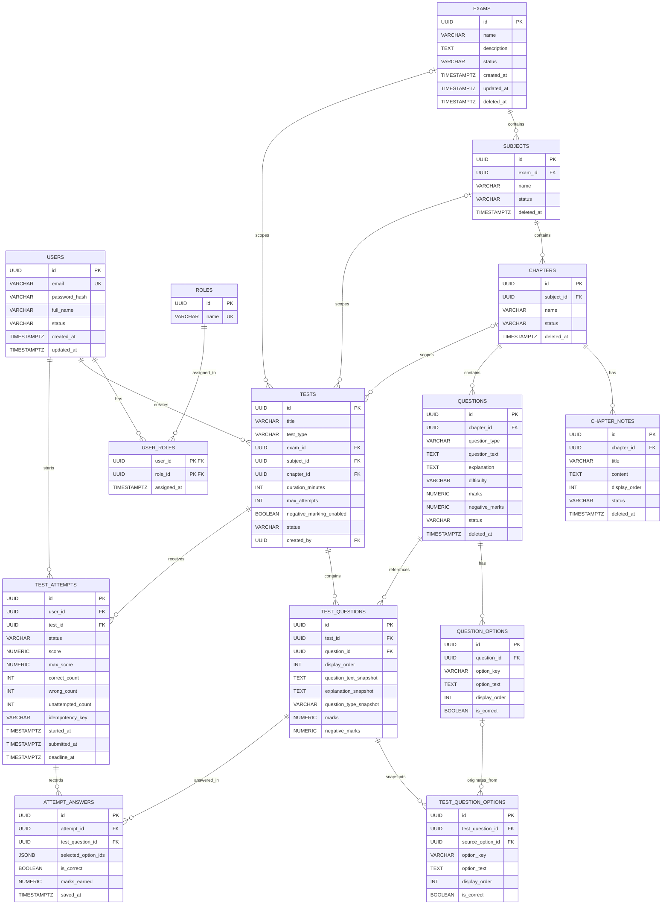

## Database Design

VrnxStudy uses PostgreSQL to store user accounts, learning content, question banks, tests, and student attempts.

The schema separates reusable questions from published test questions. When a question is added to a test, its content and options can be stored as snapshots, helping preserve the version used in that test.

### Entity Relationship Diagram



### How the schema is organized

**1. Users and roles**

- `users` stores user account information.
- `roles` defines the supported roles: `ROLE_STUDENT`, `ROLE_ADMIN`, and `ROLE_SUPER_ADMIN`.
- `user_roles` connects users and roles through a many-to-many relationship.

**2. Learning content**

The learning hierarchy is:

`EXAMS → SUBJECTS → CHAPTERS`

- `chapter_notes` stores notes associated with chapters.
- `questions` stores the reusable question bank.
- `question_options` stores the options belonging to each question.

**3. Test builder**

- `tests` defines a test, its scope, duration, attempt limit, and marking configuration.
- `test_questions` associates questions with tests and stores snapshots of question content and marking values.
- `test_question_options` stores the options associated with each test-question snapshot.

A question can be reused across different tests without requiring each test to depend entirely on the current question text.

**4. Student attempts**

- `test_attempts` tracks a user's attempt, including status, score, timing, and answer counts.
- `attempt_answers` stores the answer record for each test question within an attempt.
- `selected_option_ids` is a JSONB array containing selected option IDs.

The schema permits an answer to remain ungraded while `is_correct` is `NULL`.

### Database constraints and indexes

The schema uses several PostgreSQL features to protect data integrity:

- UUID primary keys generated with `gen_random_uuid()`.
- Foreign keys to enforce relationships between records.
- Unique constraints to prevent duplicate role assignments, question options, and test-question entries.
- Check constraints to validate statuses, difficulty levels, marking values, and test scope.
- Indexes on commonly queried foreign keys and status fields.
- Soft-delete timestamps on selected learning-content tables.
- Flyway migrations to manage schema changes.

The application uses Hibernate schema validation rather than relying on Hibernate to create or modify the database schema.

```properties
spring.jpa.hibernate.ddl-auto=validate
spring.flyway.enabled=true
spring.flyway.locations=classpath:db/migration
```

> **Note:** `attempt_answers.selected_option_ids` is a JSONB array, not a foreign-key relationship to `test_question_options`. Application-level validation is therefore important to ensure that selected options belong to the relevant test question.
